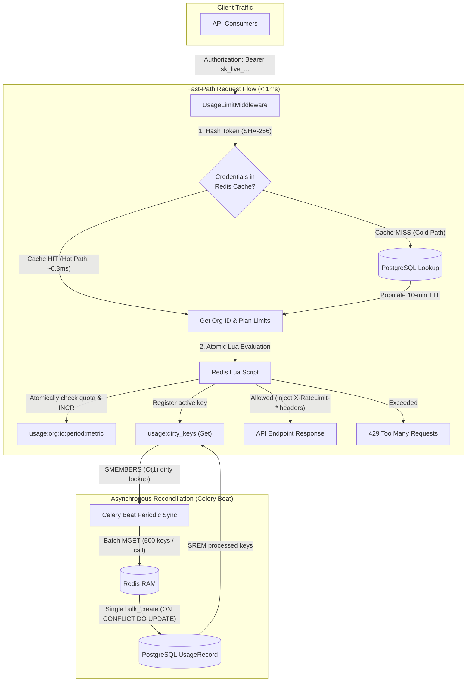

# SaaS Metering & Quota Enforcement Engine

[](https://github.com/hossein-rahmati/SaaS-Metering/actions/workflows/ci.yml)


A high-throughput, multi-tenant SaaS metering and rate-limiting engine engineered to eliminate database write amplification and handle concurrent quota enforcement with sub-millisecond latency.

Built with **Django REST Framework**, **Redis**, **Celery Beat**, and **PostgreSQL**.

---

## ⚡ System Architecture



---

## 🎯 Engineering Highlights & Design Decisions

### 1. TOCTOU Race Condition Elimination via Atomic Redis Lua
* **The Problem:** Standard check-then-act rate limiters (`cache.get()` followed by `cache.incr()`) suffer from Time-of-Check to Time-of-Use race conditions. Under 50 concurrent requests near the quota boundary, all 50 can read an unexhausted counter and breach plan limits.
* **Our Solution:** Implemented an atomic Redis Lua script ([`LUA_ATOMIC_RATE_LIMIT`](apps/metering/services.py)). Quota evaluation, counter incrementation, 35-day TTL configuration, and dirty-key tracking execute atomically in a single Redis evaluation cycle with zero chance of quota overruns. Verified by multi-threaded concurrency pytest assertions.

### 2. Fast-Path Credential Caching (0 Database Hits)
* **The Problem:** Querying PostgreSQL on every request for `APIKey` and `Subscription` turns an in-memory rate-limiter into a database-bound bottleneck.
* **Our Solution:** Credential validation and plan metadata are cached in Redis with a 10-minute TTL. Hot-path requests authenticate and meter entirely from memory in **< 1ms**, generating **0 SQL queries** (verified with `django_assert_num_queries(0)`).
* **Instant Invalidation:** Revoking a key immediately evicts its cache entry, blocking unauthorized access with zero delay.

### 3. Write Amplification Prevention & Non-Blocking Celery Sync
* **The Problem:** Writing counters directly to PostgreSQL on every HTTP request degrades database throughput. Conversely, polling Redis with `KEYS *` blocks the single-threaded Redis event loop.
* **Our Solution:**
  1. Active keys are added to a Redis `usage:dirty_keys` set during atomic increments ($O(1)$).
  2. Celery workers read only modified keys without scanning the keyspace, falling back to non-blocking `scan_iter` if needed.
  3. Batched `MGET` queries fetch values in chunks of 500 in a single network round-trip.
  4. PostgreSQL records are synchronized via `bulk_create(..., update_conflicts=True)` performing an `INSERT ... ON CONFLICT DO UPDATE` upsert.

### 4. Stripe-Grade API Key Security
* Raw API key secrets (`sk_live_...`) are **never stored in the database**.
* Only one-way `SHA-256` cryptographic hashes and masked prefixes (`sk_live_a1b2...`) are persisted.
* Secret tokens are revealed strictly once upon creation.

---

## 📋 Rate Limit & Quota Headers

All authenticated responses provide RFC-compliant rate limit telemetry:

| Header | Description | Example |
| :--- | :--- | :--- |
| `X-RateLimit-Limit` | Maximum allowed requests in the current monthly period | `1000` |
| `X-RateLimit-Remaining` | Remaining requests available before quota exhaustion | `942` |
| `X-RateLimit-Reset` | UTC Unix epoch timestamp marking the start of the next billing period | `1790812800` |
| `Retry-After` | Seconds remaining until quota reset (returned on HTTP 429) | `184200` |

---

## 📊 Performance Benchmarks

Stress-tested using **ApacheBench (`ab`)** on a test environment running Gunicorn (4 workers, 2 threads per worker) backed by Redis 7 and PostgreSQL 16.

### 1. Hot-Path Quota Consumption (HTTP 200 OK)
* **Traffic:** 5,000 requests @ 50 concurrent connections
* **Throughput:** **2,021 requests / second**
* **Total Elapsed Time:** 2.47 seconds
* **Latency Profile:**
  * **Mean (across concurrent requests):** **0.49 ms**
  * **P50 (Median):** 20 ms
  * **P90:** 40 ms
  * **P95:** 47 ms
  * **P99:** 126 ms
* **Success Rate:** 100% (0 failed requests)

### 2. Quota-Exceeded Rejection Path (HTTP 429 Too Many Requests)
* **Traffic:** 5,000 requests @ 50 concurrent connections
* **Throughput:** **3,210 requests / second**
* **Total Elapsed Time:** 1.56 seconds
* **Latency Profile:**
  * **Mean (across concurrent requests):** **0.31 ms**
  * **P50 (Median):** 13 ms
  * **P90:** 27 ms
  * **P95:** 32 ms
  * **P99:** 49 ms

```bash
# Run benchmark locally with 5,000 requests at 50 concurrency:
ab -n 5000 -c 50 -H "Authorization: Bearer <API_KEY>" http://127.0.0.1:8000/api/sample/
```

---

## 📖 Interactive API Documentation


Interactive OpenAPI 3.0 documentation is auto-generated using `drf-spectacular`:

* **Swagger UI:** [http://127.0.0.1:8000/api/docs/](http://127.0.0.1:8000/api/docs/)
* **ReDoc:** [http://127.0.0.1:8000/api/redoc/](http://127.0.0.1:8000/api/redoc/)
* **OpenAPI Schema (YAML/JSON):** [http://127.0.0.1:8000/api/schema/](http://127.0.0.1:8000/api/schema/)

---

## 🚀 Quickstart Guide

### Option 1: Run with Docker Compose (Recommended)

Start all services (PostgreSQL, Redis, Django Web, Celery Worker, Celery Beat):

```bash
docker compose up -d --build
```

Access Swagger UI at `http://127.0.0.1:8000/api/docs/`.

### Option 2: Local Development with `uv`

Ensure PostgreSQL and Redis are running locally, then:

```bash
# 1. Install dependencies
uv sync

# 2. Run database migrations
uv run python manage.py migrate

# 3. Start development server
uv run python manage.py runserver 127.0.0.1:8000

# 4. Start Celery Worker (separate terminal)
uv run celery -A config worker -l info

# 5. Start Celery Beat Scheduler (separate terminal)
uv run celery -A config beat -l info
```

---

## 🧪 Automated Testing & Verification

The test suite validates atomic concurrency, zero-database query assertions, Redis cache eviction, and bulk database synchronization.

```bash
# Run full test suite
uv run pytest -v
```

### End-to-End Walkthrough via HTTP Client

An interactive [`test.http`](test.http) file is included for VS Code (*REST Client*) and JetBrains IDEs, containing step-by-step requests:
1. List public subscription tiers (`GET /api/v1/plans/`)
2. Generate a hashed API key (`POST /api/v1/keys/`)
3. Test hot-path quota consumption & observe `X-RateLimit-*` headers (`GET /api/sample/`)
4. Verify usage summary (`GET /api/v1/usage/`)
5. Revoke key & verify instant cache invalidation (`POST /api/v1/keys/{id}/revoke/`)

---

## 🛠 Tech Stack

* **Language:** Python 3.12+ (managed with `uv`)
* **Framework:** Django 6.1, Django REST Framework
* **Cache & Memory Store:** Redis 7, `django-redis`
* **Task Queue & Scheduler:** Celery 5.6, Celery Beat
* **Database:** PostgreSQL 16
* **API Documentation:** OpenAPI 3.0.3 via `drf-spectacular`
* **Testing:** `pytest`, `pytest-django`, ThreadPoolExecutor concurrency tests
* **Containerization:** Docker, Docker Compose

---

## 🤝 Contributing

Contributions, issues, and feature requests are welcome! Anyone is encouraged to fork this repository, suggest improvements, or submit a Pull Request:

1. **Fork the Repository**
2. **Create your Feature Branch** (`git checkout -b feat/my-new-feature`)
3. **Commit your Changes** (`git commit -m 'feat: add my new feature'`)
4. **Push to the Branch** (`git push origin feat/my-new-feature`)
5. **Open a Pull Request**

Please make sure all tests pass (`uv run pytest`) and the schema validates before submitting.

---

## 👤 Author

**Hossein Rahmati**
* GitHub: [@hossein-rahmati](https://github.com/hossein-rahmati)
* Email: [rmthossein@gmail.com](mailto:rmthossein@gmail.com)

---

## 📄 License

Distributed under the MIT License.