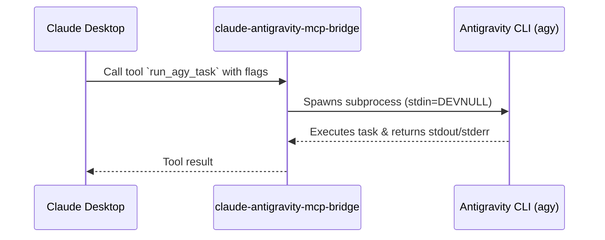

# Claude Antigravity MCP Bridge


A Model Context Protocol (MCP) bridge enabling Claude Desktop to execute tasks seamlessly via the Google Antigravity CLI (`agy`).

This bridge exposes the Antigravity CLI to Claude Desktop as a native tool, allowing Claude to harness all capabilities of the Antigravity ecosystem, including its models, skills, plugins, and background workers, completely free from the constraints of a standard chat interface.

## Architecture



## Setup & Installation

Ensure you have Python 3.9+ installed and the Antigravity CLI available in your system path.

1. **Clone the repository:**
   ```bash
   git clone https://github.com/mahdi/claude-antigravity-mcp-bridge.git
   cd claude-antigravity-mcp-bridge
   ```

2. **Create a virtual environment:**
   ```bash
   python -m venv .venv
   # Windows:
   .\.venv\Scripts\activate
   # macOS/Linux:
   source .venv/bin/activate
   ```

3. **Install the package:**
   ```bash
   pip install .
   ```

## Configuration in Claude Desktop

Update your `claude_desktop_config.json` (accessible via Claude Desktop > Settings > Developer > Edit Config) to point to the bridge:

```json
{
  "mcpServers": {
    "claude-antigravity-bridge": {
      "command": "C:\\path\\to\\claude-antigravity-mcp-bridge\\.venv\\Scripts\\python.exe",
      "args": ["-m", "claude_antigravity_bridge"]
    }
  }
}
```
*Note: Replace `C:\\path\\to\\` with the actual absolute path to the cloned repository. Restart Claude Desktop after making this change.*

## Usage

Once configured, simply instruct Claude Desktop:
> "Run the agy bridge and use the default model to print 'Hello'."

Claude will automatically know how to format flags like `--print` and `--model` because the tool description embeds a comprehensive Antigravity cheatsheet.

## Security Considerations

- The bridge passes prompts directly to the `agy` CLI. Be cautious of prompt injection.
- Interactive terminal prompts from `agy` are forcefully skipped (`--dangerously-skip-permissions`) to prevent the MCP process from hanging. Ensure your local agents are configured with appropriate safety boundaries.