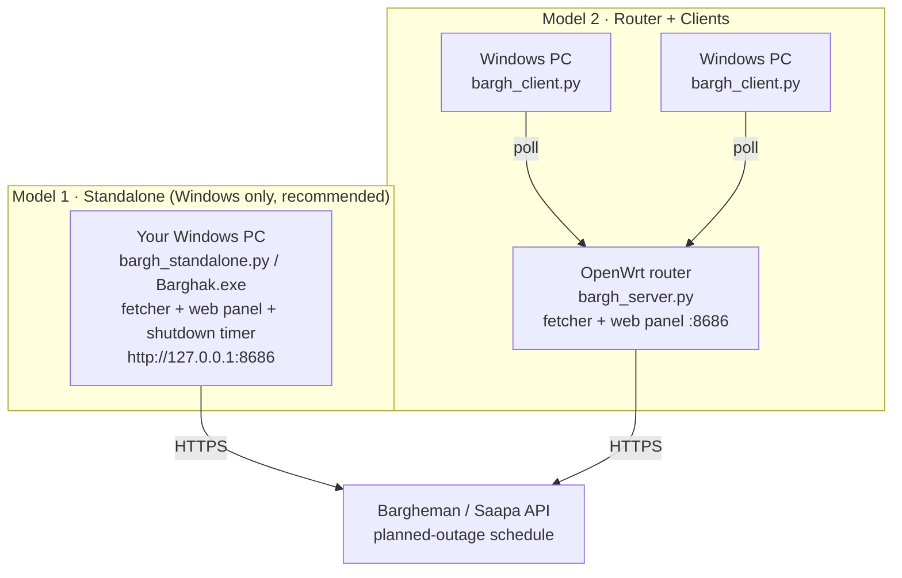

# Barghak ⚡

**Auto-shutdown watchdog for planned power outages.** Barghak fetches the planned-outage schedule of your electricity bill from the Bargheman (Saapa) portal, shows it on a live web dashboard, and safely shuts your Windows PC down a few minutes **before** the blackout starts — no more sudden power cuts killing your unsaved work.

**English** | [فارسی](README.fa.md)

[](LICENSE)

## Highlights

- 📅 Fetches the outage schedule for today (Jalali) + the next 5 days
- 🖥️ Live web dashboard: countdown to the next outage, 6-day schedule table, covered-systems list, logs, manual refresh button
- ⏱️ Arms the Windows shutdown timer `lead_minutes` (default 5) before the outage starts
- 🔁 Self-healing: the timer is re-armed after schedule changes or reboots, and cancelled if the outage is cancelled
- 🧊 Rate-limit friendly: checks only on odd Tehran hours with a hard cap of 16 requests/day, and zero automatic requests once today and tomorrow are known
- 🔐 No secrets in the source: the token and bill ID live only in your local `config.json` or environment variables
- 🧩 Python 3.8+ standard library only — no `pip install` needed

## How it works

Two deployment models:



| Model | Needs an OpenWrt router? | Best for |
|---|---|---|
| **Standalone** (`standalone/`) | No | Most users — everything runs on the PC being protected |
| **Router + clients** (`router/` + `client/`) | Yes | Multiple PCs on a LAN, with the always-on router as the hub |

## Getting your bill ID and token

The project ships with **no credentials**. You need two values:

1. **Bill ID** — your 12-digit electricity bill ID (printed on the bill, visible in bargheman.com).
2. **Bearer token** — grab it from your browser:
   1. Log in at [bargheman.com](https://bargheman.com/)
   2. Open DevTools (`F12`) → **Network** tab
   3. Open the planned-outages page and find the `PlannedBlackoutsReport` request
   4. Copy the `Authorization` header value (the part after `Bearer `)

The token expires (roughly after a year). If the API starts returning 401, just repeat the steps above with a fresh token.

> ⚠️ Treat the token like a password. `config.json` is gitignored — never commit it.

## Model 1 — Standalone (Windows, recommended)

One file combines the fetcher, the web panel, and the shutdown timer. No router, no dependencies.

### Install from Releases (no Python needed)

1. Download **`Barghak.exe`** from the latest [Release](../../releases) into a folder, e.g. `C:\Barghak\`
2. Copy `standalone/config.example.json` next to it as `config.json` and fill in `bill_id` and `token`
3. Run `standalone/install-task.bat` — it creates a hidden background task that starts at every logon
4. Open the dashboard: **http://127.0.0.1:8686**

### Run from source

```sh
cd standalone
copy config.example.json config.json   # then fill in bill_id + token
python bargh_standalone.py             # console run (good for first-time testing)
install-task.bat                       # permanent hidden autostart (pythonw)
```

### Configuration

`config.json` is looked up next to the script/exe first, then in `%LOCALAPPDATA%\BarghStandalone\`:

| Key | Default | Description |
|---|---|---|
| `bill_id` | — *(required)* | Electricity bill ID |
| `token` | — *(required)* | Bargheman Bearer token |
| `lead_minutes` | `5` | Shut down N minutes before the outage starts |
| `poll_seconds` | `150` | How often the schedule is re-checked |
| `force_shutdown` | `false` | `true` = force-close apps (`shutdown /f`) |
| `dry_run` | `false` | `true` = log only, never actually shut down |
| `listen_host` | `0.0.0.0` | Set `127.0.0.1` to keep the panel local to this PC |
| `listen_port` | `8686` | Web panel port |
| `days_ahead` | `5` | How many days ahead to fetch |
| `max_requests_per_day` | `16` | Hard daily cap on API requests |

The `BGH_TOKEN` / `BGH_BILL_ID` environment variables override the config file, and `BGH_DRY_RUN=1` forces dry-run mode.

### Safety nets

- **Pause:** create the file `%LOCALAPPDATA%\BarghStandalone\pause` — it cancels the pending timer and stops arming new ones (delete the file to resume)
- **Cancel now:** run `shutdown /a` in any CMD window
- **Uninstall:** run `standalone/uninstall-task.bat`

## Model 2 — Router + clients

### Server on OpenWrt

```sh
ssh root@192.168.1.1
mkdir -p /etc/bargh
apk update && apk add python3 ca-bundle    # OpenWrt 24.10+ (older releases: opkg install python3)
```

From Windows (Git Bash or PowerShell):

```sh
scp router/bargh_server.py root@192.168.1.1:/etc/bargh/
scp router/bargh.init root@192.168.1.1:/etc/init.d/bargh
scp router/config.json root@192.168.1.1:/etc/bargh/config.json   # renamed + filled from config.example.json
```

On the router:

```sh
chmod +x /etc/init.d/bargh
/etc/init.d/bargh enable     # autostart on boot
/etc/init.d/bargh start
```

Dashboard: **http://&lt;router-ip&gt;:8686** from any device on the LAN.

RAM usage is about 20–30 MB. On flash-limited routers use the lighter set:
`apk add python3-light python3-urllib python3-ssl python3-email python3-logging python3-http`

The router's clock should be correct (NTP is on by default). The script computes Tehran time on its own, independent of the router timezone.

### Clients on Windows PCs

1. Put `client/bargh_client.py` on each PC. Default server: `http://192.168.1.1:8686` — override with the `BARGH_ROUTER` environment variable.
2. Run `client/install.bat` — creates a hidden logon task per user.
3. Uninstall: `client/uninstall.bat`. Pause: create `%LOCALAPPDATA%\BarghClient\pause`. Cancel now: `shutdown /a`.

Every client reports in and appears in the dashboard's client list.

> Tip: clients can also point at a PC running the standalone version (`BARGH_ROUTER=http://<that-pc>:8686`) — it doubles as a hub.

## Rate-limit friendly syncing

- While **today or tomorrow** has no cached entry, checks run only on odd Tehran hours (01, 03, …, 23), at most once every 45 minutes
- Once **both today and tomorrow** are scheduled, automatic requests stop completely — empty far-out days mean "not published yet", not "no outage"
- Hard cap of `max_requests_per_day` (default 16); the manual refresh button has a 10-minute cooldown
- Responses are cached to disk, so restarting the service costs zero extra requests

## Testing (without real shutdowns)

Standalone:

```sh
cd standalone
set BGH_DRY_RUN=1
python bargh_standalone.py
```

Router model, all on one Windows machine:

```sh
cd router
python bargh_server.py                # terminal 1
```

```sh
cd client
set BARGH_ROUTER=http://127.0.0.1:8686
set BARGH_DRY_RUN=1
python bargh_client.py                # terminal 2
```

In dry-run mode nothing is ever executed — planned actions are only logged.

## Project structure

```text
standalone/   Model 1 - all-in-one Windows app (fetcher + web panel + shutdown timer)
router/       Model 2 - OpenWrt server
client/       Model 2 - Windows shutdown client
```

## Notes

- Logs: standalone → `%LOCALAPPDATA%\BarghStandalone\standalone.log` · router-model client → `%LOCALAPPDATA%\BarghClient\client.log`
- This project relies on the unofficial API of bargheman.com; if the portal changes, the fetcher may need an update.

## License

[MIT](LICENSE)