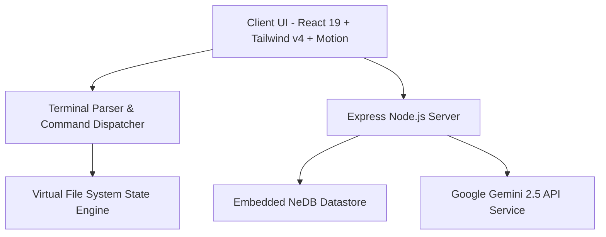

<div align="center">

  

  # 🐧 LinuxQuest | لینوکس کوئست

  ### پلتفرم بازی‌محور و شبیه‌ساز تعاملی لینوکس و DevOps


<p align="center">
  <b>یک محیط زنده، هوشمند و تعاملی برای یادگیری خط فرمان Bash، مدیریت فایل‌سیستم، امنیت سرور و ابزارهای DevOps به زبان فارسی</b>
</p>

[مشاهده دمو زنده](https://ais-pre-iobsbjn7qr7wequqirpmyi-764185084053.us-east1.run.app) • [گزارش باگ / پیشنهاد](https://github.com/) • [مستندات و سرفصل‌ها](#-سرفصل‌های-آموزشی)

</div>


---

## 📖 درباره پروژه (About Project)

**لینوکس کوئست (LinuxQuest)** یک پلتفرم نسل جدید یادگیری تعاملی لینوکس است. این سامانه بدون نیاز به نصب ماشین مجازی (VirtualBox/VMware) یا سرور ابری، یک شبیه‌ساز واقعی خط فرمان لینوکس (Bash) به همراه فایل‌سیستم مجازی درختی (VFS)، ویرایشگر متنی تعاملی `nano`، سناریوهای شغلی DevOps و منتور هوش مصنوعی (Google Gemini) را مستقیماً داخل مرورگر در اختیار شما قرار می‌دهد.

---

## ✨ ویژگی‌های برجسته (Key Features)

### 💻 ۱. شبیه‌ساز خط فرمان Bash و فایل‌سیستم مجازی (VFS)
* **پشتیبانی از بیش از ۳۵ دستور واقعی:** `ls`, `cd`, `pwd`, `mkdir`, `rm`, `cp`, `mv`, `cat`, `grep`, `sed`, `chmod`, `chown`, `systemctl`, `ufw`, `ps`, `htop`, `tree`, `curl`, `ping` و...
* **پشتیبانی از پایپ‌ها و ریدایرکشن‌ها:** قابلیت فیلتر داده‌ها با استفاده از `|`، `>` و `>>`.
* **تکمیل خودکار (TAB Autocompletion):** هوشمند بر اساس محتویات دایرکتوری جاری و تاریخچه دستورات با کلیدهای جهت‌نما (`↑` و `↓`).
* **ویرایشگر زنده `nano`:** شبیه‌سازی کامل ویرایش متنی فایل‌ها با کلیدهای میانبر استاندارد لینوکسی.

### 🧠 ۲. دستیار هوشمند و منتور هوش مصنوعی (AI Mentor)
* مجهز به **Google Gemini API** جهت تحلیل هوشمند کدهای خطا و خروجی شل.
* ارائه سرنخ‌های گام‌به‌گام برای حل سناریوها بدون سوزاندن پاسخ نهایی.
* قابلیت تشریح عمیق هر دستور لینوکسی و سناریوهای کاری مرتبط.

### 🎯 ۳. سیستم گیم‌فیکیشن، امتیاز (XP) و لیدربورد
* کسب امتیاز تجربه (XP) و ارتقای سطح متناسب با حل ماموریت‌ها.
* اعطای نشان‌های تخصصی (LPIC-1 Explorer, SysAdmin Guru, Bash Ninja, Security Specialist).
* لیدربورد رقابتی بلادرنگ بین تمام مهندسان و کاربران سامانه.

### 📱 ۴. طراحی واکنش‌گرا و کیبورد اختصاصی موبایل
* **نوار ابزار و کیپد مجازی ترمینال:** کلید‌های تک‌لمسی `TAB`، `Ctrl+C`، کاراکترهای کاربردی (`|`, `/`, `-`, `~`, `sudo`) و دکمه اختصاصی اجرا.
* **ناوبری شناور زیرین (Bottom Nav):** سوییچ روان بین ترمینال، ماموریت‌ها، فایل‌سیستم، دانشنامه و دستیار AI روی تلفن همراه.

### 🎨 ۵. لندینگ پیج مدرن با Motion و Letter Glitch
* پس‌زمینه پویا با افکت ماتریکس و انیمیشن کاراکترها بر پایه HTML5 Canvas و کتابخانه `motion`.
* کنسول تعاملی پیش‌نمایش دستورات و سناریوهای واقعی مهندسی سیستم.
* سیستم صوتی با افکت‌های لمسی صفحه‌کلید و پیروزی (Sound Synthesizer).

### 🛡️ ۶. پنل مدیریت پیشرفته و ابزارهای سئو (Admin Console)
* داشبورد آمار بازدیدها، تعداد کاربران و ثبت درخواست‌ها.
* مدیریت کامل و افزودن مقالات تخصصی لینوکس و پایگاه دانش.
* تنظیمات سئو، مدیریت متاتگ‌های تاییدیه Google Search Console، تولید داینامیک `sitemap.xml` و `robots.txt`.

---

## 🗺️ سرفصل‌های آموزشی (Curriculum Roadmap)

| سطح | عنوان سرفصل | دستورات و مباحث کلیدی |
|:---:|:---|:---|
| **سطح ۱** | **مقدمات و ناوبری فایل‌سیستم** | `pwd`, `ls -la`, `cd`, `mkdir`, `touch`, `cp`, `mv`, `rm` |
| **سطح ۲** | **ویرایشگرها و مجوزهای امنیتی** | `nano`, `chmod 755/644`, `chown`, `sudo`, `cat`, `head`, `tail` |
| **سطح ۳** | **خط لوله‌ها و پردازش حرفه‌ای متن** | `| (Pipes)`, `grep -E`, `sed`, `sort`, `uniq`, `wc -l`, `cut` |
| **سطح ۴** | **مدیریت سرویس‌ها، امنیت و DevOps** | `systemctl`, `journalctl`, `ufw firewall`, `ps aux`, `htop`, `curl` |

---

## 🛠️ معماری فنی و پشته فناوری (Tech Stack)



* **Frontend:** [React 19](https://react.dev/), [TypeScript](https://www.typescriptlang.org/), [Vite](https://vitejs.dev/), [Tailwind CSS v4](https://tailwindcss.com/)
* **Animations & UI:** [Motion](https://motion.dev/), [Lucide React](https://lucide.dev/), Canvas Confetti
* **Backend:** [Express.js](https://expressjs.com/), [Node.js](https://nodejs.org/)
* **AI & LLM:** [@google/genai (Gemini Models)](https://ai.google.dev/)
* **Database & Persistence:** NeDB Promises (Embedded Lightweight JSON Database)
* **Fonts & Typography:** Vazirmatn (وزیرمتن) & JetBrains Mono

---

## 🚀 راهنمای نصب و راه‌اندازی محلی (Getting Started)

### پیش‌نیازها
* **Node.js:** نسخه `v18.0.0` یا بالاتر
* **npm:** نسخه `v9.0.0` یا بالاتر

### مراحل اجرا:

۱. **کلون کردن مخزن:**
```bash
git clone https://github.com/your-username/linuxquest.git
cd linuxquest
```

۲. **نصب وابستگی‌ها:**
```bash
npm install
```

۳. **پیکربندی متغیرهای محیطی:**
فایل `.env.example` را به `.env` تغییر نام داده و کلید API جمینای را وارد کنید:
```bash
cp .env.example .env
```
درون فایل `.env`:
```env
GEMINI_API_KEY=your_gemini_api_key_here
PORT=3000
```

۴. **اجرای سرور در محیط توسعه (Dev Server):**
```bash
npm run dev
```

۵. **مشاهده برنامه:**
مرورگر خود را باز کرده و به آدرس زیر بروید:
```
http://localhost:3000
```

---

## 📦 اسکریپت‌های پروژه (Available Scripts)

* `npm run dev`: اجرای همزمان کلاینت و سرور توسعه با `tsx`.
* `npm run build`: بیلد پروداکشن برای استقرار با `vite build` و باندل سرور با `esbuild`.
* `npm run start`: اجرای بیلد نهایی سمت سرور (`node dist/server.cjs`).
* `npm run lint`: بررسی خطاهای تایپ‌اسکریپت و اعتبارسنجی کدها (`tsc --noEmit`).

---

## 📂 ساختار دایرکتوری‌ها (Project Structure)

```text
├── src/
│   ├── components/
│   │   ├── LandingPage.tsx       # صفحه لندینگ اصلی و دموها
│   │   ├── LetterGlitch.tsx      # کامپوننت افکت ماتریکس و گلیچ متنی با Canvas
│   │   ├── Terminal.tsx          # شبیه‌ساز ترمینال، کیپد موبایل و هندلر دستورات
│   │   ├── QuestSidebar.tsx      # سرفصل‌های آموزشی و لیست مراحل
│   │   ├── GuidedStepCoach.tsx   # مربی گام‌به‌گام و راهنمای هر مرحله
│   │   ├── VfsExplorer.tsx       # کاوشگر بصری ساختار فایل‌سیستم لینوکس
│   │   ├── NanoEditor.tsx        # ویرایشگر زنده متنی نانو
│   │   ├── AiMentorModal.tsx     # دستیار هوش مصنوعی Gemini
│   │   ├── CheatSheetModal.tsx   # دانشنامه دستورات و برگه تقلب
│   │   ├── UserProfileModal.tsx  # پروفایل، لیدربورد و نمایش نشان‌ها
│   │   ├── AdminModal.tsx        # پنل مدیریت مقالات، آمار و سئو
│   │   └── AuthModal.tsx         # سیستم ورود و ثبت‌نام کاربران
│   ├── lib/
│   │   ├── defaultFileSystem.ts  # ساختار پیش‌فرض و اولیه فایل‌سیستم لینوکس
│   │   ├── questsData.ts         # اطلاعات ماموریت‌ها، راهنماها و شرایط عبور
│   │   └── sound.ts              # موتور سینث‌سایزر افکت‌های صوتی
│   ├── App.tsx                   # کامپوننت ریشه و مدیریت استیت عمومی
│   └── main.tsx                  # نقطه ورود اصلی برنامه
├── server.ts                     # بک‌اند Express، احراز هویت، API مقالات و Gemini AI
├── metadata.json                 # اطلاعات و سطح دسترسی‌های پلتفرم
└── package.json                  # تعریف وابستگی‌ها و اسکریپت‌های اجرایی
```

---

## 🤝 مشارکت در توسعه (Contributing)

از هرگونه مشارکت، گزارش باگ یا پیشنهاد برای ارتقای لینوکس کوئست استقبال می‌شود:
1. پروژه را **Fork** کنید.
2. یک برنچ جدید برای ویژگی خود بسازید (`git checkout -b feature/AmazingFeature`).
3. تغییرات خود را Commit کنید (`git commit -m 'feat: Add some AmazingFeature'`).
4. به برنچ Push کنید (`git push origin feature/AmazingFeature`).
5. یک **Pull Request** ارسال نمایید.

---

## 📄 لایسنس (License)

این پروژه تحت لایسنس **MIT** منتشر شده است. برای اطلاعات بیشتر فایل `LICENSE` را مطالعه کنید.

<div align="center">
  <sub>طراحی و پیاده‌سازی شده با ❤️ برای جامعه توسعه‌دهندگان و علاقه‌مندان لینوکس فارسی</sub>
</div>